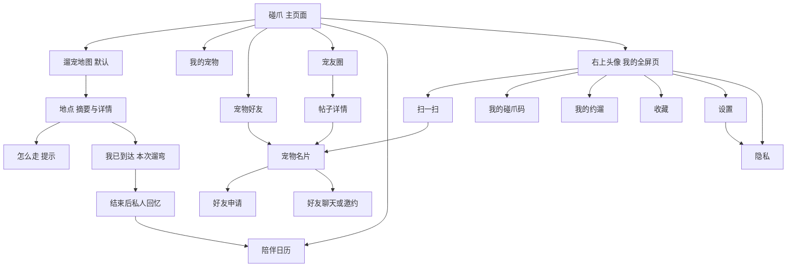
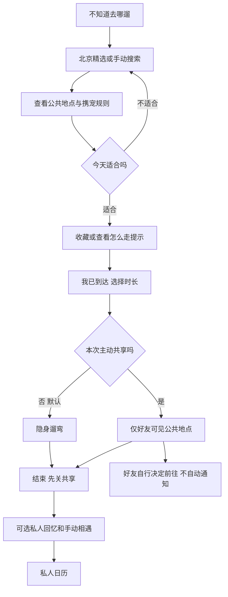
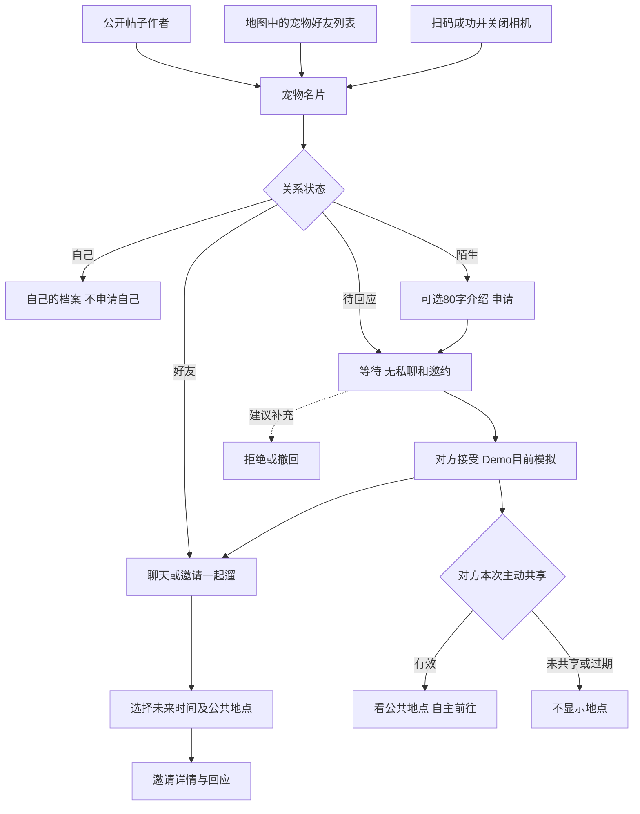

# 碰爪 · 信息架构与用户流程

更新：2026-09-05。现有结构根据[E01/E02/E07/E11](00-current-state.md)。标“建议”的路由和返回栈属于PZ-NAV-01，未实现。

## 现有导航与页面清单

当前主应用由一个page.tsx内的section、modal控制，没有每个页面独立URL。个人页另有Sheet的view；真实地图有chosen/expanded/guideExpanded；不能由有“返回”按钮推断系统浏览器历史已实现。

| 页面ID | 页面/层 | 入口及主要出口 | 需求 |
| --- | --- | --- | --- |
| PG-01 | 遛宠地图（默认主页面） | 底部地图；推荐/找地点/收藏/宠物好友；进入PG-02/05 | PZ-MAP-01、PZ-MAP-02 |
| PG-02 | 真实地点摘要/详情（地图内） | 列表/标记/收藏；返回地点列表、展开收起、导航/开始/贡献 | PZ-MAP-01、PZ-MAP-04 |
| PG-03 | 我的宠物（主页面） | 底部宠物；档案、照护、记录、好友、去地图 | PZ-PET-01、PZ-CAL-01 |
| PG-04 | 宠物好友（主页面） | 底部好友；在遛/好友/认识新朋友等视图；名片/聊天/邀请码 | PZ-REL-01 |
| PG-05 | 宠物名片（modal pet） | 地图好友、好友头像、帖子作者/名片按钮、扫码；申请/聊/约/地点 | PZ-PET-01、PZ-REL-01 |
| PG-06 | 好友申请（modal friend-request） | 陌生名片/帖；返回名片或提交后名片 | PZ-REL-01 |
| PG-07 | 聊天（modal chat） | 顶部消息、好友列表/名片/帖；发消息/邀请/邀请详情 | PZ-MSG-01 |
| PG-08 | 邀请表单/详情（invite / invitation-detail） | 好友、聊天、帖子、日历、我的约遛；会话/地点/原帖 | PZ-INV-01、PZ-INV-02 |
| PG-09 | 宠友圈（主页面） | 底部圈子；广场/好友圈/我的日常/收藏，发帖或PG-10 | PZ-FED-01 |
| PG-10 | 帖子详情/发布（post / publish） | 卡片/收藏/来源邀请；评论、喜欢、收藏、作者联系 | PZ-FED-02 |
| PG-11 | 陪伴日历（主页面） | 底部日历/我的；选日/切月、记录/邀请、历史展开 | PZ-CAL-01、PZ-CAL-02 |
| PG-12 | 开始/进行中遛弯（start / walk） | 地点我已到达/当前活动；隐身、结束、回忆 | PZ-WLK-01、PZ-WLK-02 |
| PG-13 | 私人回忆/地点体验（memory / contribute） | 结束/历史记录/地点；保存去日历或地点 | PZ-CAL-02、PZ-MAP-04 |
| PG-14 | 我的（全屏Sheet） | 任一主页右上头像；档案/扫描/码/约遛/收藏/日历/设置/隐私/关于 | PZ-ME-01、PZ-ME-02 |
| PG-15 | 我的子页 | scan/mycode/plans/collections/settings/privacy/about；返回/关闭 | PZ-ME-01、PZ-ME-02、PZ-QR-01、PZ-QR-02 |
| PG-16 | 导航提示（独立Dialog或route） | 真实/示例地点怎么走；确认提示后返回地点 | PZ-MAP-03 |
| PG-17 | 示例地点弹窗（place） | 遛弯好友仍引用的p1等旧地点；导航提示/宠物 | 仅Demo，不冒充真实POI |

底部五项顺序为地图、我的宠物、宠物好友、宠友圈、陪伴日历。右上“我的”是全局工具入口，不是底部“我的宠物”的改名。顶部消息目前直开演示会话，没有独立收件箱页面。

## 返回、关闭、展开收起：现状与目标

| 场景 | 现状事实 | 建议行为（PZ-NAV-01） |
| --- | --- | --- |
| 主tab切换 | go清modal并滚到顶部 | 保留当前行为或记录tab滚动，需一致验证；不结束活动 |
| 真实地点返回列表 | chosen清空，关闭指南展开，列表展开并滚顶部 | 保持；不误切tab或清收藏 |
| 展开/收起地点详情 | 只改guideExpanded；收起滚顶部 | 保持；不当作导航返回 |
| 导航提示关闭 | 独立Dialog回原地点；旧route回place | 关闭仅退出导航，不改地点 |
| 我的子页返回 | 普通子页回我的；隐私回privacyBack（我的或设置） | 保持；我的根返回关闭整个Sheet |
| 我的关闭 | Sheet关闭；资料/收藏/扫描识别用leave关闭后跳转 | 关闭回进入前主页面；返回目标来源能力另补 |
| 帖子→名片 | showPet替换modal，关名片后回底层主页面 | 返回帖子并恢复滚动/评论草稿；关闭回主页面 |
| 扫码→名片 | 释放摄像头，关闭我的层并打开pet弹窗 | 返回扫一扫静止态，需再次点击开启相机；关闭回原主页面 |
| 名片→申请 | 取消或提交后设modal=pet | 返回名片，保留原始来源信息 |
| 名片→聊天/邀请→详情 | modal替换；发送邀请后chat；详情“关闭”清modal | 返回上一层；详情来自日历/我的约遛时应回对应列表 |
| 邀请详情→地点/原帖 | 改当前主tab或modal；无来源栈 | 保留邀请详情作为返回来源；原帖失效有不可用状态 |
| 系统返回/侧滑/键盘 | 无完整路由栈证据；真机未测试T39 | 优先收键盘，再关闭当前覆盖层，再退页面；不误关闭整个App |

建议显式保存来源`originPageId/resourceId/scrollOffset`与返回栈；关闭和返回分开定义，避免只把按钮文案改成“返回”。这是产品契约，不指定框架。未保存的发布/回忆在退出时提示保留/放弃为建议，当前非所有表单都有确认。相机资源清理不得等待确认。

## 主要用户旅程

新增真人流程的拒绝/撤回、真实接收、权限撤销按05建议状态运行，不能据流程图判定已经实现。对应验收AT-01/05/10/19/21及PZ-NAV-01。
