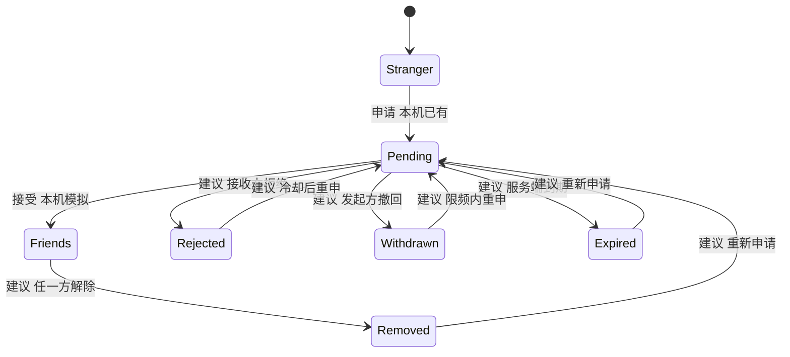

# 碰爪 · 状态流与权限矩阵

更新：2026-09-05。规则编号来自[PRD](03-prd.md)；源码证据见[00](00-current-state.md)。本机模型不提供对抗越权的安全保证。以下建议状态和服务端校验尚不存在，须按D-xx决策确认。

## 关系与好友申请

现有关系是派生结果：buddyIds有petId＝好友；否则requests有petId＝待回应；否则陌生。pending与friend并非数据库枚举，没有接收方向。contactAccess以friend分别返回canMessage和canInvite；canRequest要求非me、非好友、非pending。接受函数只能在本机模拟已有申请。[E01/E04]

| 现有事件 | 前态→后态 | 允许角色/校验 | 失败/终止 |
| --- | --- | --- | --- |
| 发申请 | 陌生→待回应 | 本机me，非本人/好友/重复；备注≤80 | 不符合不写入；仍不能聊/约 |
| 模拟接受 | 待回应→好友 | 本机点明确模拟；请求存在 | 无请求不处理；删除requests项，备注未同步清理 |
| 重复申请 | 待回应→不变 | canRequest=false | UI禁用/函数不写 |
| 拒绝/撤回/解除/拉黑 | 无对应状态 | 未实现 | 不应演示为已有能力 |

**建议目标（PZ-REL-02、PZ-REL-03，D-01/04）**：FriendRequest与Friendship独立；申请只记录一次决策，关系可解除后重新申请。

| 对象/状态变化 | 触发者/前置 | 允许操作与授权 | 失败与终止 |
| --- | --- | --- | --- |
| 无请求→pending | A发给B，两者有效、非好友、未互黑、未超限 | A控制fromPet，B控制toPet；身份取登录会话 | 重复返回同一待申请；双向申请不自动接受 |
| pending→accepted；创建active关系 | 仅B接受，未过期且请求仍pending | 事务内检查双方宠物归属/关系/黑名单 | 原子创建一次；撤回/过期/冲突则返回最新态 |
| pending→rejected | 仅B拒绝 | 不要求解释；A看到未建立好友 | 请求终态；再申请冷却D-04 |
| pending→withdrawn | 仅A撤回 | B旧卡片不能再接受 | 请求终态，重复撤回幂等 |
| pending→expired | 服务端时间达到expiresAt | 客户端不可自行延长 | 终态，可按限频规则重申 |
| active→removed | 任一关系所有者解除 | 禁止后续私聊/邀约/共享读取 | 历史处理D-08；重申不恢复旧共享 |
| 任意→blocked覆盖层 | 用户拉黑另一用户 | 推荐用户层生效，覆盖其所有宠物，避免换宠绕过 | 解除拉黑不自动恢复好友，需重新确认 |

blocked作为独立用户层限制覆盖所有关系状态，避免图中“拉黑＝好友”的误读。

## 邀请

当前Invitation.status只有待回应/已接受/已拒绝/已取消。卡片/详情用invitationLabel推导过期或到时；日期之前才可模拟回应或取消。原字段没有发送方用户ID，不能验证是谁按了接受。[E07]

| 现有状态/事件 | 转移与校验 | 终止/失败 |
| --- | --- | --- |
| 创建 | 好友+未来有效date→待回应 | 无效时间不创建；本机无投递 |
| 模拟回应 | 未来待回应→已接受/已拒绝 | 到时不显示回应按钮 |
| 取消 | 未来待回应或已接受→已取消 | 不出现在未来计划，历史可查 |
| 时间到 | 待回应显示已过期；已接受显示已到约定时间 | status本身不变；不自动完成 |

**建议目标（PZ-INV-03，D-03）**：

| 转移 | 发起者与校验 | 后续/终止 |
| --- | --- | --- |
| draft→pending | 邀请者，双方好友/未拉黑、公共地点有效、scheduledAt未来 | draft可丢弃，提交必须幂等；deadline≤约定时间 |
| pending→accepted/rejected | 受邀者，当前version、未到deadline | rejected为终态，无见面义务 |
| pending/accepted→cancelled | 建议邀请者或受邀者均可取消 | 记录actor/reason可选；双端移出计划，不改为拒绝 |
| pending→expired | 服务端到deadline | 终态，旧卡片接受应冲突 |
| accepted→awaiting_outcome | 服务端到scheduledAt | 仅表示到时，停止未来计划；仍可查看完整详情 |
| awaiting_outcome→completed | 建议双方明确确认；或选择仅保留到时状态，待D-03 | 不自动添加WalkMemory.metPetIds；无证据不声称相遇 |
| 任意活跃状态→cancelled | 建议关系解除、拉黑、地点不可用时系统终止并通知可联系方 | 不向未授权第三人泄露细节；注销保留D-08 |

并发接受与取消通过版本检查串行提交：返回唯一权威状态。接受先成功后取消仍可进入cancelled（若采用双方可取消方案）；先取消则接受不得成功。不是简单“先返回的页面获胜”。

## 遛弯/地点共享

当前Walk：未结束且startedAt≤now<expiresAt为活动；visibility独立private/friends。finishWalk保留已有endedAt或取不晚于expiresAt的结束时间并private。当前活动归history后walk=null；没有数据库状态字段或后台任务。[E05]

| 当前事件 | 前态→后态 | 校验/操作 | 终止 |
| --- | --- | --- | --- |
| 开始 | 无活动→active_private默认，或本次手选active_friends | 单本机一个活动、时长、地点选择；无需GPS证明 | 已有活动不再开 |
| 主动共享/隐身 | active_private↔active_friends | 本机当前walk | UI文字切换，不代表好友端已收 |
| 结束 | active→ended_private，归history | finishWalk先关共享 | 打开回忆，非自动发帖 |
| 超时/启动恢复 | now≥expiresAt→ended_private | 15秒时钟/启动检查 | 本机记录保存；无后台实时保证 |
| 好友可见 | Presence按好友、friends、未结束、时间有效过滤 | 仅种子好友活动列表 | 真实地图不展示虚构活动点 |

**建议目标（PZ-WLK-03）**：服务端WalkSession有active/ended/expired，visibility仍独立；ShareGrant绑定walk与授权受众。每次读取同时检查会话、授权、好友、屏蔽、期限；无需等定时清理任务执行才拒绝过期。结束/隐身在一个事务中撤销授权，再通知订阅端清理。

- 新次默认private，不继承上次授权；并发两设备启动同一宠物只能一个成功。
- 共享只提供placeId和公共地点资料，控制ownerId等必要字段；不向好友返回原始定位点/路径。
- D-05推荐固定本次开启时的好友受众，再按实时好友关系过滤；当前Demo使用动态buddyIds，无固定快照。
- D-06推荐在线撤销反馈+带有效期的短展示租约；B断网/回前台先隐藏旧卡，确认可见再展示。离线A撤销尚未到服务端必须明确待同步，不声称别人立即已看不到。
- 终止条件：用户结束、隐身（只终止共享）、expiresAt、关系失效/拉黑（只撤对应受众）、账号或宠物失效、服务端风控停用。断网租约阈值未定，不写成已承诺秒数。

## 扫码与资源生命周期

现有状态为idle/requesting/scanning/reading/error。成功、离开是事件；下面不是新增枚举。[E10]

| 前态+事件 | 结果 | 校验/失败处理 | 清理/终止 |
| --- | --- | --- | --- |
| idle→点击相机 | requesting | getUserMedia，后置优先，无音频 | 未点不请求权限 |
| requesting→允许 | scanning | 检查generation仍当前，video可用 | 过时授权返回立即stop全部track |
| requesting→拒绝/不支持 | error | 解释并提供相册/重试 | release |
| idle/scanning→选图 | reading | PNG/JPEG/WebP≤8MB；读取失败可换图 | 先停相机，finally revokeObjectURL |
| scanning/reading→已知他人码 | 名片 | 白名单parse；不加好友 | 先release，再回调 |
| 扫到me | error | 本人码解释 | 相机已停，不开外链 |
| 未知/普通网址/无二维码 | error | 不返回任意名片、不打开URL | 释放资源，可重新开始 |
| 帧解码异常 | error | 识别中断提示，可重试/相册 | cancel帧、stop轨道、清srcObject |
| 返回/关闭/卸载/切后台 | idle或退出 | generation失效，旧结果不可跳转 | 清轨道/帧；回来需主动开启 |

PZ-QR-03建议新增服务端解析中、码已撤销/失效、宠物不可用、无网络；解析失败只重试，不本地猜身份。真实本人由ownerUserId判断，不能使用字面me判断别人的码。

## 帖子、评论与消息

| 对象 | 现有事实 | 建议状态和角色 | 错误/终止 |
| --- | --- | --- | --- |
| 帖子 | 内存草稿→本机posts；无审核/删除，time为文本 | draft→uploading→pending_review→published；作者可delete，审核可reject/hidden，编辑规则待D-08 | 上传/发布失败保留草稿；删除/屏蔽后所有入口失效，计数最终一致 |
| 评论 | 每帖草稿→该帖string[]，无作者/时间 | pending→published/rejected/deleted；作者删除自己的，运营审查 | 原帖不可用或权限变化拒绝提交；重复clientId不重复 |
| 喜欢/收藏 | 本机ID数组toggle | 服务端按userId+目标唯一；收藏只对本人可读 | 目标删除显示不可用或清理，不能绕过目标权限 |
| 消息 | 按petId草稿→messages[petId]，mine=true | 客户端sending/failed；服务端accepted；对端ack可delivered，read为可选D-08 | 失败重试同clientMessageId；发送前关系再校验；拒绝不生成成功气泡 |
| 私人回忆 | 结束Walk中的memory可写/改 | 仅所有者读写，媒体独立归属；建议deleted | 非好友也不得读取别人日历；账号删除按保留策略 |

这些是产品状态，不预设队列、中间件或某个数据库已经部署。

## 位置/私聊/邀请分别授权

下表“现”仅指本机规则，“建议”指未来服务端强制校验。读公共帖子不自动读公开之外的数据。

| 访问者与对象关系 | 公开名片/公开帖子 | 发好友申请 | 读取对方本次地点 | 新私聊 | 新邀请 |
| --- | --- | --- | --- | --- | --- |
| 本人 | 现：自己的资料 | 现：否 | 现：可看自己的记录，非共享授权 | 现：不能给自己 | 现：不能给自己 |
| 陌生人 | 现：可 | 现：可一次待回应 | 现：否 | 现：否 | 现：否 |
| 申请待回应 | 现：可 | 现：不可重复 | 现：否 | 现：否 | 现：否 |
| 好友，对方private或无活动 | 现：可 | 现：无需 | 现：否 | 现：可 | 现：可 |
| 好友，活动有效且friends | 现：可 | 现：无需 | 现：可读种子公共地点；建议还查受众授权 | 现：可 | 现：可 |
| 好友，共享结束或到期 | 现：可 | 现：无需 | 现：否 | 现：可 | 现：可 |
| 已拒绝/撤回 | 现：无完整状态 | 建议限频后可申请 | 建议否 | 建议否 | 建议否 |
| 已解除关系 | 现：无此操作 | 建议可重申 | 建议否 | 建议禁止新增，历史另定 | 建议否 |
| 被拉黑/封禁 | 现：无完整状态 | 建议否 | 建议否 | 建议否 | 建议否 |
| 第三人C/资源ID猜测 | 现：无后端可测 | 建议按自己身份申请 | 建议403/404，不泄露位置存在性 | 建议不可读写A-B会话 | 建议不可读/回应A-B邀请 |
| 未登录 | 现：无业务登录，站点访问认证另计 | 建议需登录 | 建议否 | 建议需登录且好友 | 建议需登录且好友 |

用户A/B拥有的宠物关系授权到主人会话的映射待D-01；禁止用“认识其中一只宠物”自动开放其同住人的位置。

## 设备权限与业务权限分离

| 系统权限 | 用途 | 拒绝后的退路 | 不赋予 |
| --- | --- | --- | --- |
| 前台位置 | 点击定位找地点 | 手动北京搜索/推荐 | 好友位置共享、后台轨迹、私聊 |
| 相机 | 点击开启扫一扫 | 相册识码/展示自己的码 | 自动加好友、麦克风 |
| 相册选取/保存 | 本地图片和二维码 | 取消返回、继续文字操作；真机保存行为待测 | 全相册批量读取、媒体公开 |
| 通知（未来） | 邀请/消息提醒 | 应用内收件箱 | 读取位置、扩大关系权限 |

当前浏览器文件选择不等于已经实现原生相册权限；正式SDK权限按08官方资料另做平台验收。
