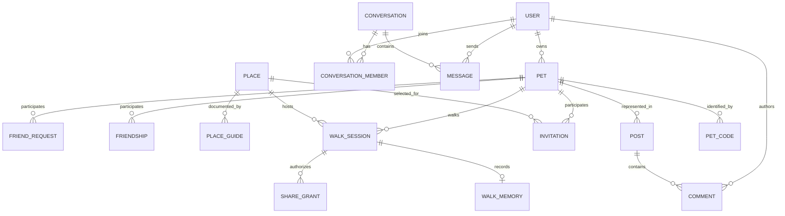

# 碰爪 · 核心数据模型与接口需求

更新：2026-09-05。事实和建议分章。接口为产品契约草案，不声明存在真实业务后台；采用方案前需确认D-01/03/05/06/08。

## 当前数据与数据源

[源码证据E01/E05/E06/E09/E10/E13](00-current-state.md)。应用React内存State序列化到localStorage的`qunaliu-walk-demo-v2`，兼容旧`qunaliu-demo-v1`。旧键保留不是产品名称错误。没有从真实账号取得me身份。

| 对象 | 当前字段/归属 | 数据源和缺项 |
| --- | --- | --- |
| 用户 | 没有User对象；主人显示文字由宠物名拼接 | 站点ChatGPT访问验证不构成业务userId；无账号归属 |
| 自己的宠物 | legacy.pet：name/breed/age/bio；隐含me | 本机单对象；无petId/ownerId/生日/物种/头像上传 |
| 其他宠物 | petNetwork固定id/name/breed/age/photo/temper/desc/relation/placeId/remaining/status/size | 种子虚构；relation描述不等于数据库好友关系 |
| 好友 | buddyIds:string[] | 默认豆包/曲奇/年糕；单向本机列表，语义声称双方好友但无真实双方 |
| 好友申请 | requests:string[]、requestNotes:Record<petId,string> | 仅本机发出的目标ID和备注；无requestId/方向/时间/拒绝撤回 |
| 地点 | Place：id/name/area/location/source/kind/desc/features/caution/size/quiet，及旧x/y/distance/minutes/route/photo | 高德POI+四处资料目录+本机贡献+旧虚构p1–p5；旧画布坐标不能当经纬度 |
| 携宠指南/体验 | petGuide：district/badge/fee/entry/rules/checkedAt/sources；experience：note/features/updatedAt；photoUrl/contributed | 指南为静态公开资料整理；个人体验本机。来源元数据≠逐条已实勘 |
| Presence | petId/placeId/startedAt/expiresAt/visibility/endedAt? | seedPresences构造固定好友演示活动；不由其他真实用户上传 |
| 当前Walk/历史 | id/petId/placeId/startedAt/expiresAt/visibility/endedAt?/memory? | state.walk单对象、history数组；毫秒时间、crypto.randomUUID；设备时钟 |
| 回忆 | ownerMood/petMood/note/photo/metPetIds | 仅自己选择，图片Data URL；不是双方相遇证据 |
| 邀请 | id/friend/place/date/note/status/inviterName?/sourcePostId? | friend是宠物ID；date为本地日期字符串，无时区/createdAt/deadline/响应者 |
| 帖子 | id/title/body/image/author/pet/topic/category/likes/city/time | author为显示名，pet关联固定宠物/me；time非机器时间，无删除/审核 |
| 评论 | comments[postId]:string[] | 无独立ID、用户/宠物作者、时间、状态 |
| 消息 | messages[petId]:{id,text,mine}[] | 无conversationId、用户ID、时间/送达/已读；mine只能区分显示方向 |
| 照护 | checkins：id/kind/time/recordedAt? | 新记录毫秒时间，旧recordedAt可能缺失；不能靠显示文本猜日期 |
| 喜欢/收藏/关注 | liked/saved/following/placeSaved:string[] | 本机；following为历史字段，不开放聊天权限 |
| 设置/草稿 | preferences.walkDuration；chatDrafts/commentDrafts及发布表单 | 时长存本机；草稿多为页面内存，不承诺刷新/跨设备保存 |
| 碰爪码 | 固定prefix+演示petId | 白名单解析；me没有全球唯一性，无撤销/服务端解析 |

当前存储恢复覆盖缺字段和错误顶层容器，未穷举行对象损坏。storage事件支持同源顺序编辑，整对象覆盖没有事务合并；私人内容和公开内容存同一浏览器状态不构成服务端访问隔离。

## 建议身份与关系方案（D-01待确认）

推荐首批每账号一只宠物，预留User 1:N Pet，但不暴露多宠/家庭共享入口。User承担登录、数据权利和操作责任；Pet是名片与关系主体；Friendship关联宠物对，同时保留所有者身份用于权限校验。一个主人对一位主人使用一个Conversation，消息带宠物上下文，避免未来多宠各建重复收件箱。

如果选择主人级好友，则接受一个宠物申请是否开放其他宠物互动必须明确；如果选择家庭共同管理，则PetMembership的角色、邀请/撤销、历史消息和位置可见都需要独立授权。均不能把“好友宠物”自动映射为“整户所有人可看位置”。

## 建议核心模型

以下新增字段全部是目标设计，不是当前数据库。ID建议不透明且稳定；客户端不能通过修改ownerUserId转移归属。所有时间存UTC、接口RFC3339，展示Asia/Shanghai；服务端生成createdAt/updatedAt及状态时间。

| 对象 | 必需产品字段 | 关联与归属/唯一约束 |
| --- | --- | --- |
| User | id/authSubject/status/displayName/createdAt/updatedAt/deletionRequestedAt? | 身份服务生成；联系方式仅账户用途，名片不返回 |
| Pet | id/ownerUserId/name/species/breed?/birthDate?或ageText/avatarMediaId?/bio/temper?/status | 归User；多宠/家庭D-01；可选/必填和公开字段D-02 |
| FriendRequest | id/fromUserId/toUserId/fromPetId/toPetId/note/status/createdAt/expiresAt/respondedAt?/withdrawnAt?/version | 一个宠物对仅一个有效pending；接受事务创建Friendship |
| Friendship | id/petAId/petBId/ownerAId/ownerBId/status/acceptedAt/removedAt?/removedBy?/version | 无序宠物对唯一active；负责人更换不自动继承授权 |
| UserBlock/Report | blockerUserId/blockedUserId/createdAt；reporterId/targetType/targetId/reason/status/resolvedAt? | 拉黑推荐用户级；举报内容访问限举报人和运营 |
| Place | id/provider/providerPoiId/name/address/location/crs/city/district/type/status/entryLocation?/verifiedAt? | provider+providerPoiId唯一；crs=GCJ-02；公开点与非公开地址不能混用 |
| PlaceGuide | id/placeId/admissionScope/rules/feeNote/facilities/quietEvidence?/sourceRefs/reviewedAt/fieldCheckedAt?/validUntil?/version | 资料与现场核验时间分开；运营维护；未知不是允许 |
| PlaceExperience | id/placeId/authorUserId/petId/note/features/mediaIds/status/createdAt/updatedAt | 用户投稿先独立保存，不能覆写PlaceGuide；审核公开方案D-07/08 |
| WalkSession | id/ownerUserId/petId/placeId/status/visibility/startedAt/expiresAt/endedAt?/endReason?/version | 每宠物最多一个active；不要求保存用户精确GPS或轨迹 |
| ShareGrant | id/walkId/audienceType/audienceIds?/enabledAt/revokedAt?/expiresAt/leaseUntil?/version | 本次授权；D-05固定快照推荐，始终再验最新关系；D-06租约待定 |
| WalkMemory/Encounter | walkId/ownerUserId/ownerMood?/petMood?/note?/mediaIds/metPetIds/updatedAt | 私人回忆；Encounter为本人声明，不是对方确认的Attendance |
| Invitation | id/fromUserId/toUserId/fromPetId/toPetId/placeId/scheduledAt/responseDeadline/note/sourcePostId?/status/version/createdAt/respondedAt?/cancelledAt?/cancelledBy?/completedAt? | 作者与响应者独立；完成字段仅D-03确认采用后启用 |
| Post | id/authorUserId/petId/title/body/mediaIds/city?/visibility/status/createdAt/updatedAt/deletedAt? | 公开广场是public；是否增加其他发布范围D-08；不默认附地点 |
| Comment | id/postId/authorUserId/petId/body/status/createdAt/updatedAt/deletedAt? | 独立作者归属，删除与审核可追溯 |
| Conversation/Message | participantUserIds/contextPetIds；id/conversationId/senderUserId/clientMessageId/body/acceptedAt/deliveredAt? | 会话只参与者可读，发送另查好友；(senderUserId,clientMessageId)唯一 |
| CareRecord | id/ownerUserId/petId/kind/recordedAt/note? | 私人记录；允许重复事件，不唯一到天 |
| Media | id/ownerUserId/mimeType/size/storageKey/status/createdAt/deletedAt?/purpose | 私人媒体签名访问；公开前完成处理，去不必要EXIF位置 |
| PetCode | id/tokenHash/petId/version/status/createdAt/revokedAt?/expiresAt? | 公开名片发现，不是登录或关系权限令牌；可轮换；有效期D-01配套 |
| UserPreference/Consent | userId/walkDuration；purpose/version/grantedAt/revokedAt? | 系统权限、通知、单次共享分别记录，不用总协议同意替代 |

图表达目标关联，不是现有表结构。一个Invitation包含两位参与者，用from/to明确方向；图中参与关联不表示任意宠物均可读。

## 已有真实接口

| 入口 | 当前契约 | 边界 |
| --- | --- | --- |
| GET /api/map-config | configured:boolean；配置齐全返回公开JS Key，否则key:null；no-store | 密钥不返回；不是用户登录/业务配置接口 |
| GET /_AMapService/{path} | 按允许的v3/v4/v5路径代理高德，固定上游；Worker补Key/安全码 | 未配置503，非法路径404，上游重定向/不可达502；超时15秒；无社交账号授权 |
| AMap.PlaceSearch / Geolocation | 浏览器SDK北京关键词、主动定位 | 非碰爪业务API；不证明账号/关系/共享已接通 |

源路由文件为[地图代理](../../app/%255FAMapService/[...path]/route.ts#L1)。不在文档写出真实凭据。源码存在amapNavigation/Walking类型，不代表页面启用了路线或外跳。

## 建议接口产品契约

下面路径仅为便于评审的命名草案。所有私有接口从会话识别用户，客户端不能指定操作者身份冒充别人。读写返回资源ID、权威状态、version、serverTime；分页cursor。写入带idempotencyKey或clientMessageId，状态命令带expectedVersion。

| 契约ID/建议接口 | 输入与成功结果 | 权限和主要失败 |
| --- | --- | --- |
| API-01 认证/GET /me | 身份凭据换会话；返回本人ID及受控宠物 | 无效/过期401；不得使用全局me代替账号 |
| API-02 GET /pets/{id}/card；PATCH /pets/{id} | 公共白名单名片；编辑允许字段返回版本 | 公共读取与私有编辑分离；非所有者403，不存在404 |
| API-03 GET /places；GET /places/{id} | city/query/可选用户主动位置/筛选/cursor；目录及来源时间 | 无结果空数组；地图不可用标明降级；不要替返回虚构点 |
| API-04 POST /place-experiences；PUT /saved-places/{id} | POI ID、体验、媒体；保存本人体验/收藏 | 需登录，审核状态明确；重复收藏幂等；地点失效410或业务码 |
| API-05 POST /friend-requests；GET /friend-requests | toPetId/fromPetId/note；返回pending；列表区分incoming/outgoing | 操作者控制fromPet；重复返回现有请求；429限频，不暴露拉黑原因 |
| API-06 POST /friend-requests/{id}/accept或reject或withdraw；DELETE /friendships/{id} | expectedVersion；返回终态和关系 | 接受/拒绝仅收件者，撤回仅发件者；过期/冲突409，解除任一方 |
| API-07 POST /blocks；POST /reports | targetUserId或对象类型/ID/原因；返回记录和处理状态 | 拉黑本人账号范围；举报不自动授予被举报私有内容读取 |
| API-08 GET /conversations/{id}/messages；POST .../messages | cursor；clientMessageId/body；返回acceptedAt | 读限参与者；发送再验好友/拉黑；失败不显示已送达；重复返回同消息 |
| API-09 POST /invitations；GET /invitations | toPetId/fromPetId/placeId/scheduledAt/note/sourcePostId?；pending | 好友/公共地点/未来时间；来源帖只附属，不扩大权限 |
| API-10 POST /invitations/{id}/accept或reject或cancel | expectedVersion；返回权威状态与时间 | 角色和状态按05；409后客户端刷新，不能用本地按钮强制状态 |
| API-11 POST /walks；POST /walks/{id}/end | petId/placeId/duration/本次主动visibility；WalkSession | 创建/结束仅所有者；默认private；已有活动409；重复end返同终态 |
| API-12 PUT /walks/{id}/sharing；GET /friends/presences | enabled、受众确认、expectedVersion；返回授权有效期/撤销版本；读返回允许的公共地点 | 服务端逐对象检查活动/关系/受众/屏蔽/时间；不可见返回空结果，不返回旧地点 |
| API-13 GET /calendar；PUT /walks/{id}/memory；POST /care-records | 时间区间/时区；回忆字段；照护时刻；本人记录 | 只所有者读写；不自动发布，不自动确认邀请完成 |
| API-14 GET/POST /posts；DELETE /posts/{id}；POST /posts/{id}/comments | 公开feed/cursor；文本/媒体；返回审核/删除状态 | 发/删本人，管理员按角色；审核不通过说明；来源已删阻止评论 |
| API-15 POST /media/uploads；POST /media/{id}/complete | mime/size/purpose；返回上传授权，完成后Media状态 | 资源归属、大小/内容校验；失败清理未完成文件；公开/私人权限分开 |
| API-16 GET /pets/{id}/code；POST /pet-codes/resolve | 所有者生成/轮换；扫码token解析最小公共名片 | token无效/撤销/本人状态明确；扫描不建立关系 |
| API-17 GET /sync；订阅事件 | cursor→增量事件、nextCursor、serverTime | 只投递本人/授权资源；撤销事件不再带地点；重连先重新鉴权 |
| API-18 POST /account-deletion | 本人确认→进度/预计处理方式；退出会话 | 不能只隐藏账户；数据保留/备份/恢复窗口D-08决定后写正式契约 |

统一错误建议：400输入不合法、401会话失效、403无权、404对象不可见/不存在、409状态冲突、410公开资源失效、429限频、503暂不可用。避免用精细错误向陌生人证明某个私有会话或地点存在。返回requestId供排查，日志不存完整私聊/定位凭据。

## Demo迁移到真实多人

1. 先建立用户、宠物归属、关系和服务端时间。演示me、buddyIds、seedPresence、模拟接受、种子消息不自动导入为真实事实。
2. 可由用户主动选择导入自己的档案/回忆/收藏；标为本机来源。旧date缺时区、time只是文字、评论无作者时，不猜补真实作者或发生时间。
3. placeSaved按稳定POI映射；虚构p1–p5不能映射到附近真实公园冒充原记录，可留“演示地点”。个人体验与目录版本分离。
4. 图片由Data URL转受控媒体存储；重复上传去重，私人回忆不得意外公开。删除需处理缩略图、缓存、备份轮转和依法保留范围。
5. 用幂等、版本、事务完成好友接受与邀请回应；增量同步和撤销广播取代整份localStorage覆盖。离线恢复先查权限和状态再显示/补发。
6. 以AT-05–18/22–25验证跨端一致、并发、越权和删除。不能以两个浏览器标签页代替两个用户。
