# 碰爪 · 产品演示与页面说明

更新：2026-09-05。本文用于产品讲解、设计评审和真人测试前导览；需求状态以[PRD](03-prd.md)为准，返回细则以[信息架构](04-information-architecture.md)为准。页面描述依据本地源码与历史交接；不宣称本轮已逐页在线体验成功。

## 演示范围与阅读顺序

[当前演示地址](https://qunaliu-pet-community.ljhsmart1.chatgpt.site/)为Web Demo。设计基准为iPhone 15 Pro Max的430×932逻辑尺寸。首个演示城市为北京；地图服务已接入，导航仍为提示流程。好友、消息、邀请、地点共享仍含本机模拟，不能让两位真人分别打开链接后假定已可互相联系。

建议讲解顺序：找到公共地点 → 看宠物名片 → 申请好友 → 对方确认 → 约下次或本次主动共享 → 结束后保存私人回忆。宠友圈用来了解宠物和建立联系，日历用来回看陪伴，不以发帖或聊天作为每次出门的前置条件。

本文已按IMG-01–10编入用户提供的37张原始PNG。素材位于[高清PNG-手机透明底](assets/高清PNG-手机透明底/README.md)；目录README声明来源为现有Web Demo、导出日期为2026-09-05、手机内屏对应430×932逻辑尺寸，原文件为1344×2850、3倍像素密度、手机框外透明背景。本轮核查了文件尺寸、透明角和校验记录中的哈希，并按可见页面填写图注；来源与导出日期沿用用户材料声明，不作为本轮逐页线上实测、源码版本一致性或测试通过证据。图片保持原文件，不裁掉地图署名、模拟状态和隐私提示。

## 全局导航与页面层级

底部五个主入口依次为“碰爪（地图）”“我的宠物”“宠物好友”“宠友圈”“日历”。任意主页面右上头像打开全屏“我的”；“我的”是工具集合，与底部“我的宠物”不同。顶部消息当前直接进入演示会话，不是完整消息收件箱。[PG-01/03/04/09/11/14，E01/E11]

### IMG-01 主导航与工具入口

本图展示从右上头像进入的“我的”工具页；底部五个主入口可对照IMG-02地图全屏图。讲解时区分主tab切换、覆盖层关闭和子页返回；切换页面不会自动结束进行中的遛弯。系统返回和侧滑完整行为仍待PZ-NAV-01验证。

<!-- PZ-GALLERY-IMG-01-01 -->

| 图24 · 我的／个人中心 | 阅读提示 |
| --- | --- |
| 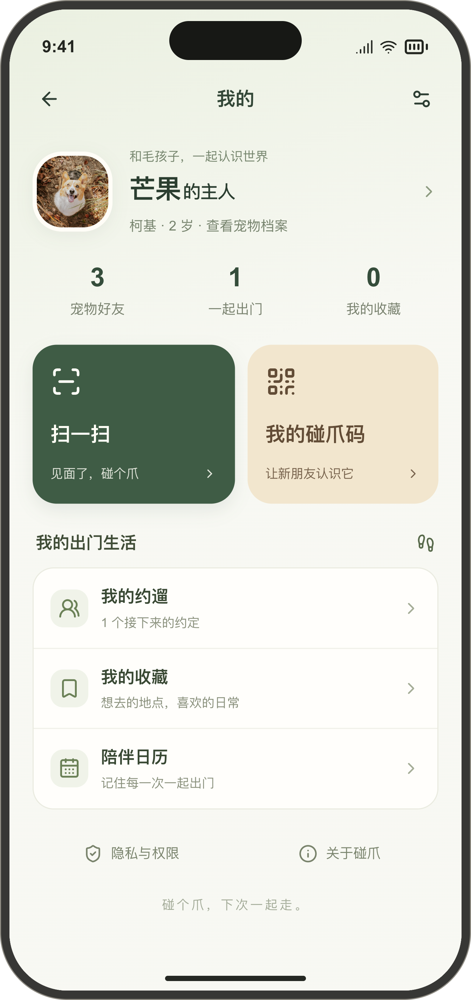 从主页面右上头像进入个人工具集合，可查看档案、扫一扫、碰爪码、约遛、收藏、日历及隐私。统计来自本机演示记录。 | 底部五个主入口见IMG-02；“我的”从右上头像进入。返回、关闭和主页面切换是不同操作。 |

<!-- /PZ-GALLERY-IMG-01-01 -->

## 找到适合宠物的公共地点

### 地图首页与地点列表

**页面目的**：帮助不知道去哪的主人挑选有资料依据的地点。**入口**：默认首页或底部碰爪；支持北京推荐、关键词找地点、收藏及宠物好友相关入口。地图定位按钮由用户主动点击，不自动开启社交共享。

**主要信息与操作**：看真实地图、精选地点及筛选入口；选择列表项或标记进入地点摘要。四处精选为爪吧温榆河示范区店、老山城市休闲公园、狼垡宠物友好专区、CKC国际宠物公园。真实目录距离显示“待定位”，当前没有计算距离并按附近重排的完整能力。四点跨城区，不应讲解为都在用户步行范围内。

**状态与边界**：地图未配置、加载、失败与就绪需分清；无结果可换关键词；拒绝定位仍能手动搜索。搜索收录只证明POI存在，不证明可以携宠。对应PG-01，PZ-MAP-01/02/05，E02/E03/E13，AT-01/02。

### IMG-02 地图与推荐地点

用户提供的地图图像可辨认北京道路、区名、地点标记与推荐列表，也保留高德署名和比例尺。本图用于正常地图页面介绍；地图失败或空白等异常状态未在本组提供，不因正常配图而视为异常测试已通过。

<!-- PZ-GALLERY-IMG-02-01 -->

| 图01 · 北京遛宠地图／推荐 | 阅读提示 |
| --- | --- |
| 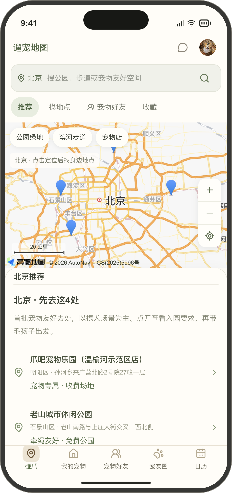 地图显示北京道路、区名、四处精选地点标记与推荐列表；底部为五个主入口。尚未定位，地图显示不代表已开启地点共享。 | 地图的道路、地名与标记清晰可读。四处地点跨城区；资料收录与附近步行可达是不同判断。 |

<!-- /PZ-GALLERY-IMG-02-01 -->

### 地点摘要、详情与怎么走

**页面目的**：出门前核对区域、费用、入口、牵绳和准入限制。选择地点后可展开规则，收起仍留在当前地点；返回地点列表不会改变收藏。当前来源在数据中保存，UI没有完整来源外链入口，D-09建议补内置信息出处页。

**怎么走**：选择步行、驾车或骑行后展示提示，再返回地点；当前没有实际启动外部导航。**我已到达**：进入开始遛弯流程，是用户声明到达，不是GPS到场验证。**收藏/体验**：保存到本机；用户体验不能改写目录的官方准入结论。对应PG-02/13/16，PZ-MAP-01/03/04，E03/E09/E13。

### IMG-03 地点详情与导航提示

按地点收起、展开、入园条件滚动位置、导航提示排列。03b是03同一详情继续向下滚动，并非另一个页面；资料核对日期不等于现场实勘，导航仍为演示提示。

<!-- PZ-GALLERY-IMG-03-01 -->

| 图02 · 老山公园／详情收起 | 图03 · 老山公园／详情展开 |
| --- | --- |
| 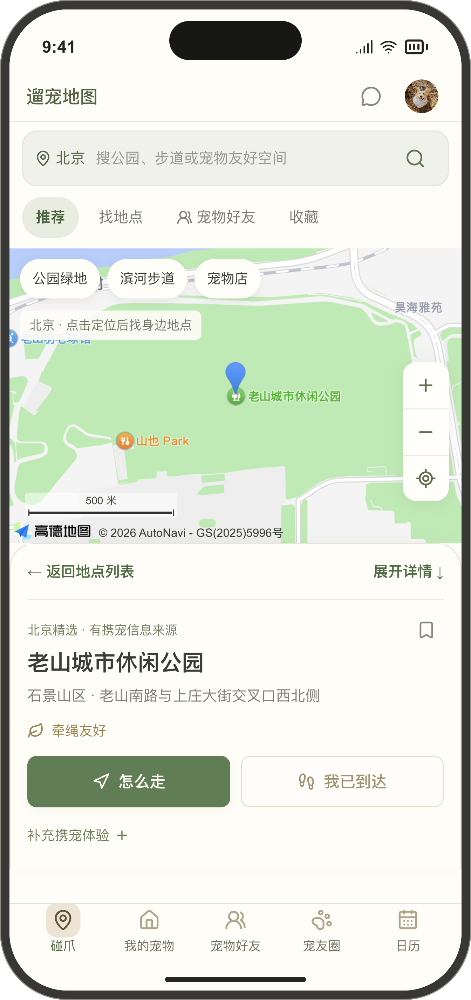 选中老山城市休闲公园后查看地图和地点摘要；可展开详情、收藏、选择怎么走或声明我已到达。到达按钮不等于GPS到场验证。 | 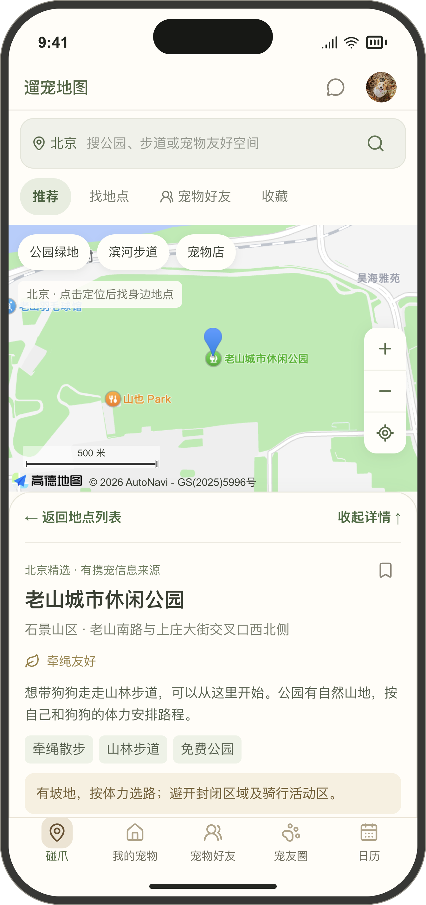 展开后显示地点介绍、牵绳友好标签及路线提醒；收起仍保留当前地点。入园条件继续向下阅读。 |

<!-- /PZ-GALLERY-IMG-03-01 -->

<!-- PZ-GALLERY-IMG-03-02 -->

| 图03b · 老山公园／入园条件滚动位置 | 图04 · 前往导航／方式确认 |
| --- | --- |
| 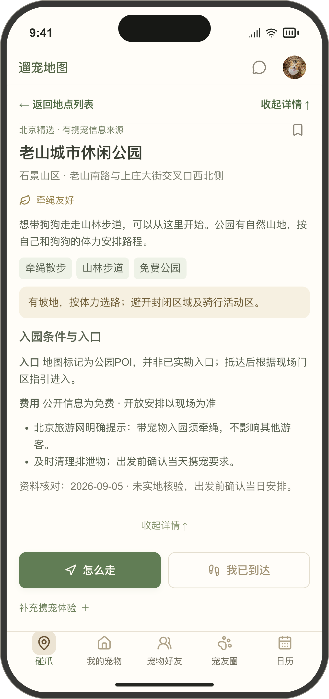 同一展开详情向下滚动，查看入口、费用、牵绳要求和资料核对日期。地图标记是公园POI；2026-09-05资料核对不等于现场实勘。 | 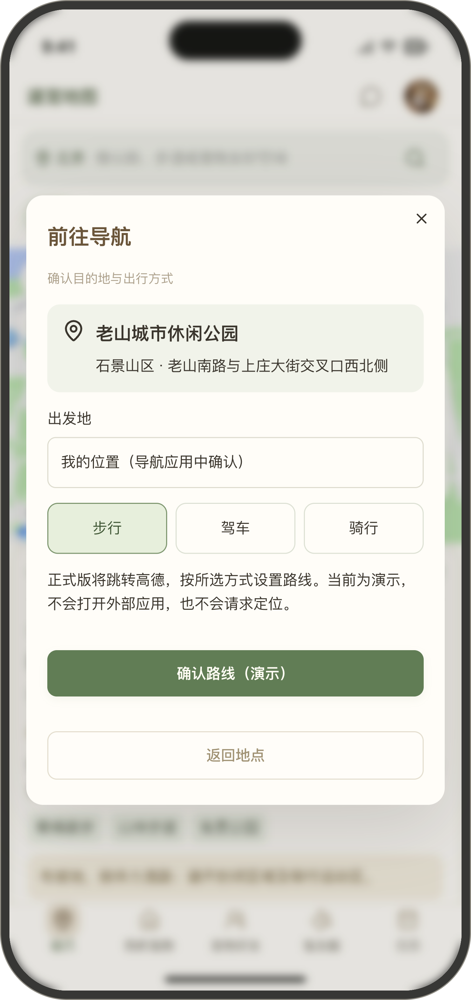 选择步行、驾车或骑行，再确认路线或返回地点。当前仅为演示提示，不打开外部应用，也不在此请求定位。 |

<!-- /PZ-GALLERY-IMG-03-02 -->

## 通过宠物名片逐步认识

### 我的宠物与档案编辑

底部“我的宠物”承载自己的宠物资料、照护和陪伴入口；“我的”中的档案工具也可进入编辑。当前可编辑姓名、品种、年龄、简介，保存本机；年龄为自由文本，头像为示例。生日计算、主人账号归属、多宠切换、家庭共同照护均不能作为已实现介绍。对应PG-03，PZ-PET-01/02，E06/E11，AT-04。

### IMG-04 我的宠物与编辑档案

对照宠物主页面与当前四字段编辑态，说明资料、照护和回忆入口。没有把生日、头像上传、多宠或家庭共同照护等未实现机制画作现成功能。

<!-- PZ-GALLERY-IMG-04-01 -->

| 图09 · 我的宠物／芒果的每一天 | 图10 · 宠物档案／编辑 |
| --- | --- |
| 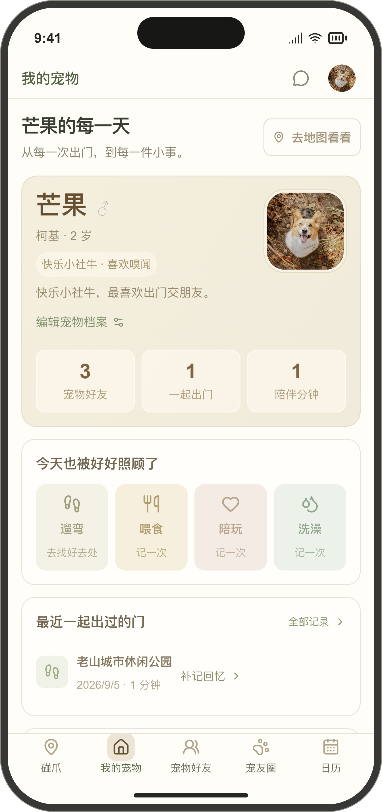 查看芒果资料、照护入口和最近遛弯；可进入编辑或补记回忆。好友数量与陪伴统计是Demo本机记录，不代表真实多人相遇。 | 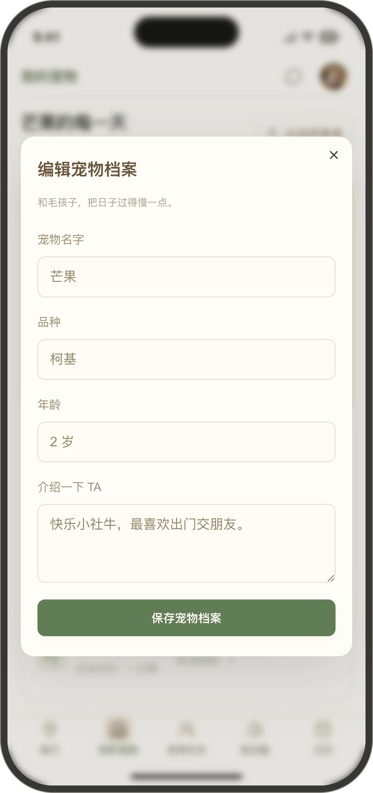 可修改名字、品种、年龄和简介，保存到当前浏览器。年龄为文本；图中没有生日计算、多宠切换或真实账号归属设置。 |

<!-- /PZ-GALLERY-IMG-04-01 -->

### 他人名片与好友申请

**入口**：帖子作者/名片按钮、地图中的宠物好友列表、好友头像或扫码结果。进入同一petId应表达同一身份和关系状态；地图中的宠物好友列表不等于地图上已经存在真实好友实时位置标记。

**陌生人**：看公开宠物资料，申请时可不填写介绍；备注最多80字。提交后等待，不能聊天或邀请。**好友**：提供聊天和邀约入口；能否看到地点还需对方本次主动共享。扫码、喜欢、评论、收藏都不会自动建立好友。

**Demo边界**：接受是明确标注的本机模拟；真实接收申请箱、拒绝、撤回和解除尚缺。名片由单一modal替换来源，关闭后可能回主页面；“返回原帖并恢复滚动/草稿”属于建议补充。对应PG-04/05/06，PZ-REL-01/02/03、PZ-NAV-01，E04/E11，AT-05–08。

### IMG-05 陌生、等待与好友名片

先看好友列表筛选，再看土豆的陌生名片、申请表单和等待状态，最后以另一位好友豆包说明好友名片。12、13、14属于土豆，32属于豆包，不能讲成同一宠物确认前后的连续流程。11、11b、32中的“望京宠友草坪”是种子演示地点，不是北京四处资料精选；拒绝、撤回和解除好友均未提供画面。

<!-- PZ-GALLERY-IMG-05-01 -->

| 图11 · 宠物好友／正在遛弯 | 图11b · 宠物好友／所有好友 |
| --- | --- |
| 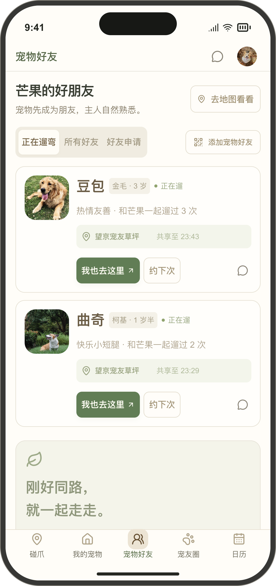 筛选正在遛弯的好友，可看示例共享地点、约下次或进入聊天。“望京宠友草坪”和相遇次数为种子演示数据，不属于四处资料精选。 | 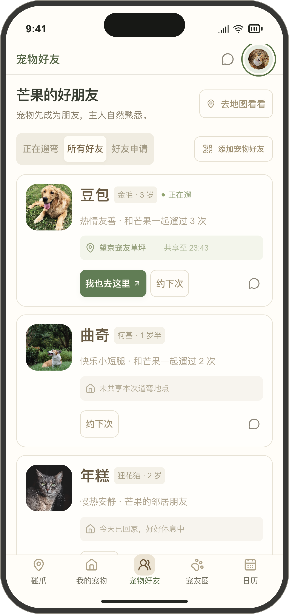 切换到所有好友，区分正在共享、未共享本次地点及已回家。此图是筛选状态切换，并非11图的单纯下滚；好友关系不自动赋予地点可见权限。 |

<!-- /PZ-GALLERY-IMG-05-01 -->

<!-- PZ-GALLERY-IMG-05-02 -->

| 图12 · 土豆名片／初次认识 | 图13 · 土豆／好友申请表单 |
| --- | --- |
| 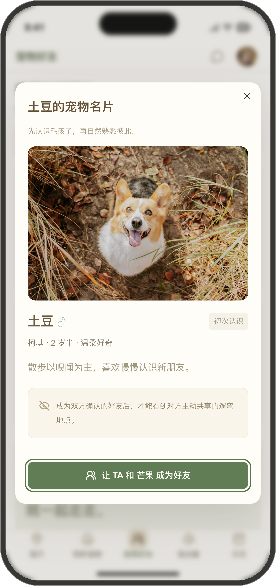 可查看公开宠物资料并申请好友，尚无聊天和邀约入口。只有双方确认后，才可能看到对方本次主动共享的公共地点。 | 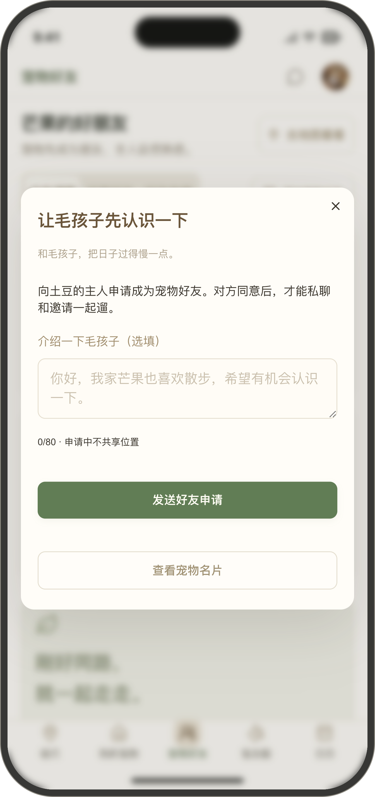 向土豆的主人发起申请，可选填80字以内介绍；申请不共享位置。发送后进入等待，尚未建立真实跨设备申请投递。 |

<!-- /PZ-GALLERY-IMG-05-02 -->

<!-- PZ-GALLERY-IMG-05-03 -->

| 图14 · 土豆名片／等待回应 | 图32 · 豆包名片／已是好友 |
| --- | --- |
| 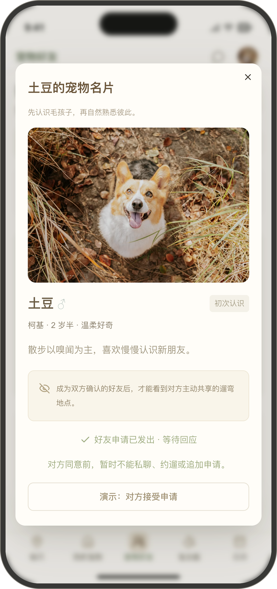 申请已发出，等待期间不能私聊、约遛或追加申请；“演示：对方接受申请”是本机模拟按钮，不能称为对方真实回应。 | 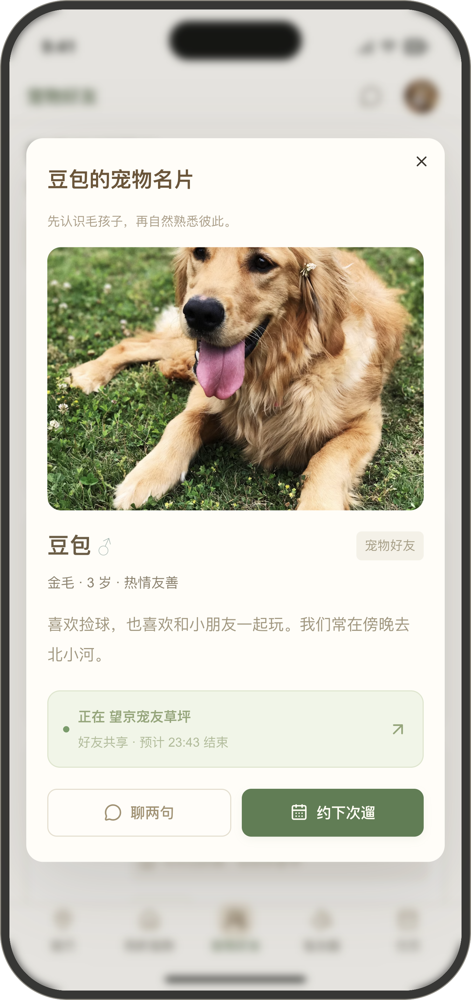 另一位已确认好友豆包可聊天、约下次，并展示种子地点“望京宠友草坪”。本图不是土豆接受后的连续状态，也不证明真实地点广播。 |

<!-- /PZ-GALLERY-IMG-05-03 -->

## 联系好友与约下一次

### 聊天与邀请卡

从好友名片、好友列表、好友帖子或顶部消息进入会话。当前按好友隔离聊天草稿，文本发送仅在本机显示；邀请卡和消息同屏。当前没有真实收件人身份、跨设备投递、已读/送达状态及未读计数，不应在讲解中把本机气泡称为“对方收到”。对应PG-07，PZ-MSG-01/02，E04/E06，AT-09。

### 约遛表单、详情和计划

选择好友、未来时间、明确公共地点，可附留言。帖子入口保存来源帖子并默认第一个真实地点；其他入口可能保留旧selected地点，提交前需核对。邀请详情包含邀请人、宠物、日期时间、地点、留言和来源。

当前可模拟接受、婉拒，以及未来待回应/已接受邀请的取消。到时待回应显示已过期，已接受显示已到约定时间，底层未写入expired/completed。未来计划排除拒绝、取消和过去邀请；历史可展开。接受不代表出席，时间到不代表完成或相遇。真实双方取消/回应截止等细则见D-03。对应PG-08/11/15，PZ-INV-01/02/03，E07，AT-10/11。

### IMG-06 好友会话与邀请状态

按示例会话、邀请表单、待回应卡片、已接受详情和我的约遛排列；所有消息与邀请均保留本机模拟边界。图中约定时间为导出时的示例，不应长期作为未来时间输入。未提供取消后、婉拒及过期画面，不能把这些图片称为完整状态验收。

<!-- PZ-GALLERY-IMG-06-01 -->

| 图15 · 豆包会话／示例消息 | 图16 · 约好下一次／邀请表单 |
| --- | --- |
| 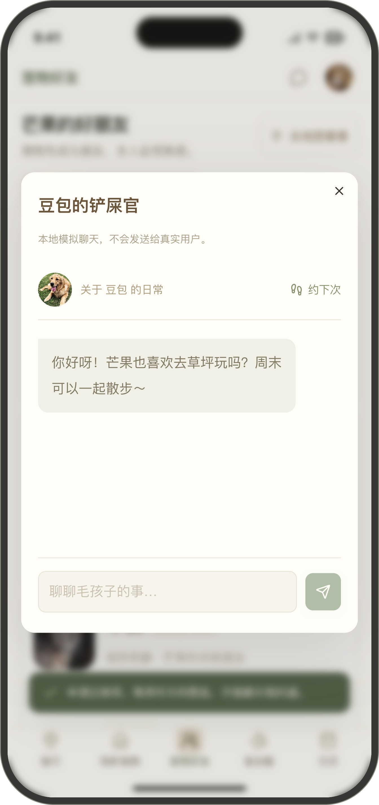 好友会话提供文字输入与约下次入口，顶部明确“本地模拟聊天”。可见气泡为示例内容，不代表真实收件人已收到。 | 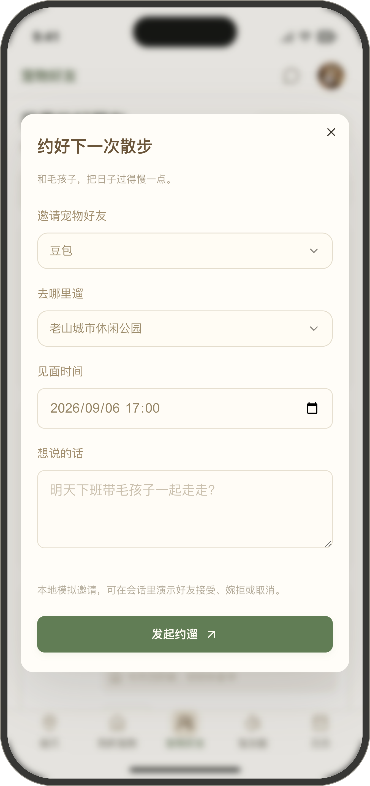 选择豆包、老山城市休闲公园及2026-09-06 17:00，填写可选留言后发起约遛。图中时间是导出时的未来示例，本机模拟邀请。 |

<!-- /PZ-GALLERY-IMG-06-01 -->

<!-- PZ-GALLERY-IMG-06-02 -->

| 图17 · 豆包会话／邀请待回应 | 图18 · 约遛详情／已接受 |
| --- | --- |
| 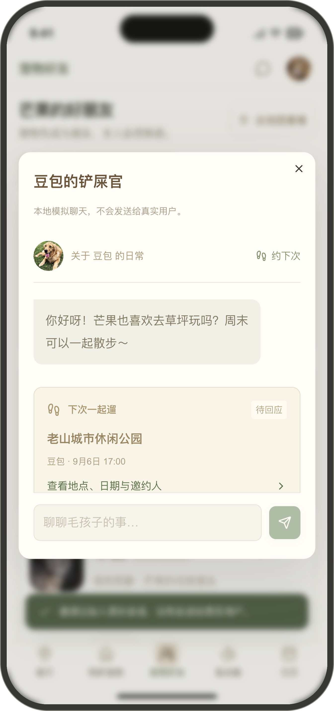 待回应邀请以会话卡片展示地点和时间，可进入详情。邀请仍仅存在本机；此图未展示取消后的历史状态。 | 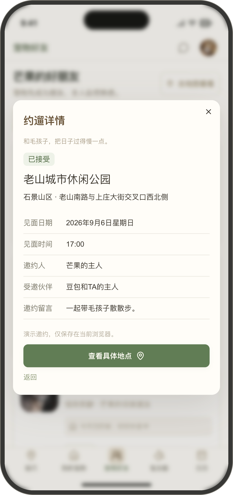 详情显示地点、日期、时间、邀请人、受邀伙伴及留言，可查看具体地点或返回。接受由Demo模拟，不代表已到场、完成或相遇。 |

<!-- /PZ-GALLERY-IMG-06-02 -->

<!-- PZ-GALLERY-IMG-06-03 -->

| 图27 · 我的约遛／已接受计划 | 阅读提示 |
| --- | --- |
| 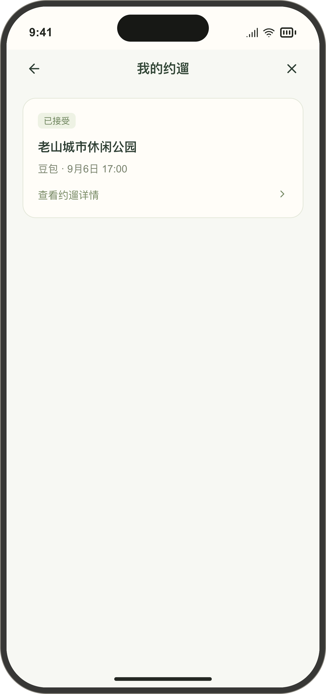 从个人中心查看接下来的已接受约定，点击进入详情。图中为豆包的老山公园演示邀请，不包含过期、拒绝或取消状态。 | 本组未提供邀请婉拒、取消后或到期的画面；这些状态继续以PRD和状态流为准，不据图片推定测试通过。 |

<!-- /PZ-GALLERY-IMG-06-03 -->

## 单次遛弯与主动地点共享

### 开始与进行中

从公共地点“我已到达”进入，选择30/60/90分钟，默认读取设置；本次默认private（隐身），用户可主动切到friends。已有活动时进入当前遛弯，不能另开第二次。

进行中可以主动共享、隐身或结束；“我的→隐私”也提供当前活动共享入口。没有活动时不展示无效开关。共享只表达公共地点，不能讲成向好友发布精确GPS或连续轨迹；定位权限与共享开关是两个独立决定。当前自己的Walk和种子好友Presence分离，没有真实广播。[PG-12/15，PZ-WLK-01/02/03，E05，AT-12–15]

### 结束与私人回忆

结束先把共享关闭并记录历史，再允许填写照片、主人/宠物心情、文字和手选真正遇到的好友。不填写回忆也保存基本遛弯。超时本机结束，启动恢复检查不等于服务端定时任务。下一次开始仍默认隐身。

建议多人版以服务端期限和撤销权限为准；断网停止失败需要显示待同步，不能承诺他人离线设备立即清除已看到的信息。固定本次受众与短展示租约均待D-05/06确认。

### IMG-07 开始、共享、隐身与结束

按默认隐身开始、隐身进行中、主动好友可见、结束后私人回忆排列。开关只影响本次公共地点共享；本组没有跨设备接收画面，好友可见不等于已完成真实广播。

<!-- PZ-GALLERY-IMG-07-01 -->

| 图05 · 开始遛弯／默认隐身 | 图06 · 遛弯进行中／隐身 |
| --- | --- |
| 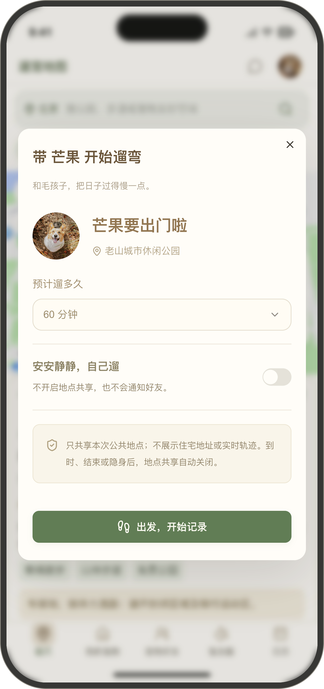 在老山公园选择本次预计时长，默认不开启地点共享；用户可主动切换后开始记录。只共享公共地点，不展示住宅或连续轨迹。 | 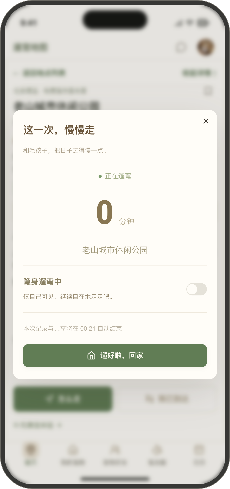 活动记录继续，开关关闭并显示仅自己可见；可主动共享或结束。图中0分钟为刚开始的本机状态，不是后台同步证据。 |

<!-- /PZ-GALLERY-IMG-07-01 -->

<!-- PZ-GALLERY-IMG-07-02 -->

| 图07 · 遛弯进行中／好友可见 | 图08 · 遛弯结束／私人回忆 |
| --- | --- |
| 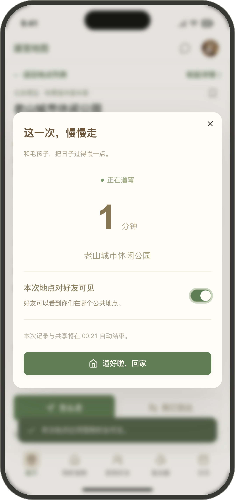 主动开启本次公共地点可见，可随时隐身或结束；界面展示自动结束时间。当前只模拟共享状态，尚未向其他设备广播。 | 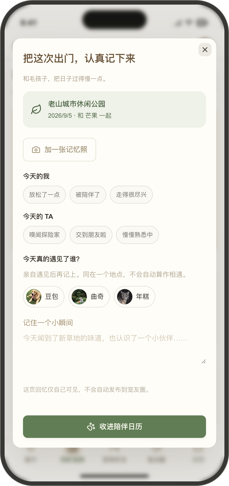 结束后可添加照片、心情、手选真正遇见的好友并记下文字，保存到陪伴日历。同地不会自动算相遇，回忆不自动发布到宠友圈。 |

<!-- /PZ-GALLERY-IMG-07-02 -->

## 宠友圈与陪伴日历

### 公开日常与帖子详情

底部宠友圈默认广场，包含好友和陌生人的示例帖子；好友圈、我的日常、收藏是筛选。详情可喜欢、评论、收藏，联系入口随作者关系变化；陌生作者只能申请或看名片。公开帖子可见不会赋予私聊、邀约或地点权限。

发帖文字与单图保存在本机；当前图片为Data URL，评论为字符串数组，缺少真实评论作者、时间和多人删除审核。示例距离要保留标识，新帖子标未共享位置。对应PG-09/10，PZ-FED-01/02/03，E08，AT-16/17。

### IMG-08 广场、详情与发布

从广场进入陌生作者汤圆和好友作者豆包的帖子，对照联系入口，再看日常发布表单。21b与22b分别是对应帖子向下滚动后的联系和评论区域，不是新增页面；20首屏的土豆与21的汤圆也不是同一帖子。

<!-- PZ-GALLERY-IMG-08-01 -->

| 图20 · 宠友圈／公开广场 | 图21 · 汤圆帖子／陌生作者首屏 |
| --- | --- |
| 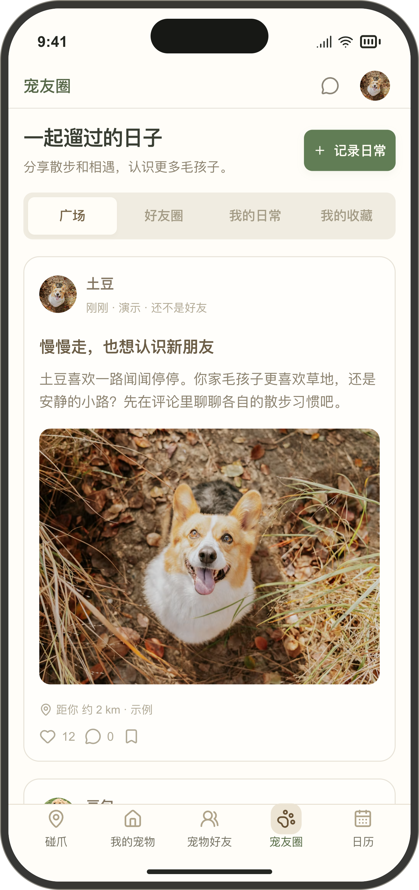 广场可包含好友和陌生人的帖子；首屏土豆标注还不是好友，可记录日常并切换筛选。图中距离、互动数与帖子为示例数据。 | 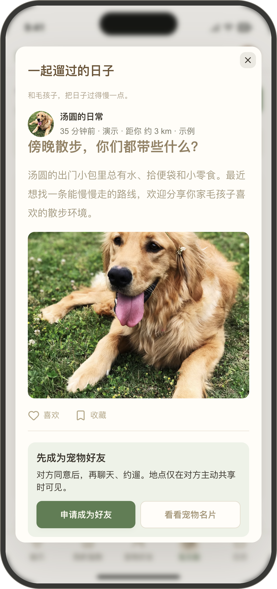 查看汤圆的散步日常，喜欢或收藏后仍是陌生关系；联系区提供申请好友与查看名片。帖子可见不赋予私聊或地点权限。 |

<!-- /PZ-GALLERY-IMG-08-01 -->

<!-- PZ-GALLERY-IMG-08-02 -->

| 图21b · 汤圆帖子／联系区滚动位置 | 图22 · 豆包帖子／好友作者首屏 |
| --- | --- |
| 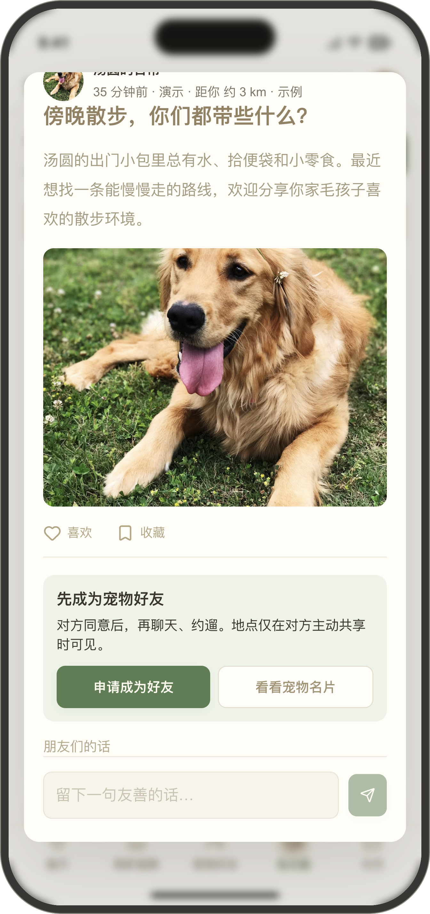 同一陌生作者详情向下滚动，完整展示先成为好友的联系限制及评论输入。可以评论不代表可以聊天、约遛或查看共享地点。 | 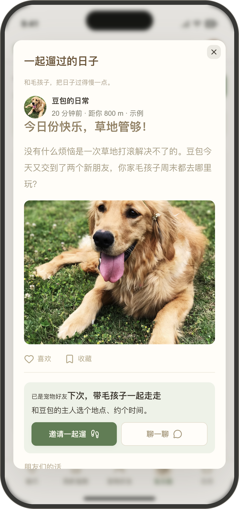 查看豆包的日常，联系区标明已是宠物好友，可邀请一起遛或聊天。帖中的示例距离不等于本次正在共享的位置。 |

<!-- /PZ-GALLERY-IMG-08-02 -->

<!-- PZ-GALLERY-IMG-08-03 -->

| 图22b · 豆包帖子／邀约区滚动位置 | 图23 · 记录日常／已选图片待发布 |
| --- | --- |
| 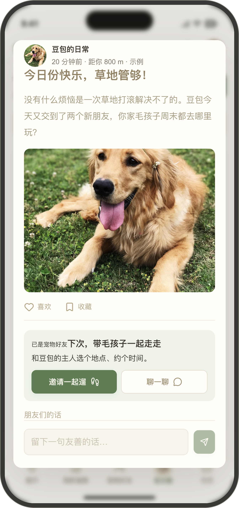 同一好友帖子向下滚动，查看完整邀约、聊天及评论入口。联系权限来自已确认好友关系；本次地点是否可见仍独立判断。 | 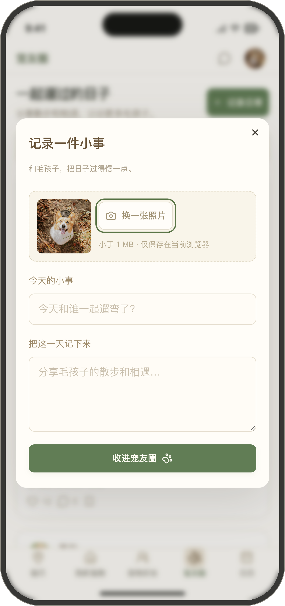 选择一张图片并填写标题和正文后收进宠友圈；图中示例图片已选、文字尚未填写。当前发布内容只保存到本机浏览器。 |

<!-- /PZ-GALLERY-IMG-08-03 -->

### 陪伴日历与回忆详情

底部日历、“我的→日历”、宠物记录均可进入。按月、日回看遛弯、照护、私人回忆和邀请，区分未来计划与历史。无记录为空态；旧照护数据缺少recordedAt时不推断发生在今天。私人日历与回忆不自动发布到广场，同地活动不自动记相遇。对应PG-11/13，PZ-CAL-01/02，E09，AT-18。

### IMG-09 日历与私人回忆

本图展示有一条老山公园本机遛弯记录的日历与补记回忆入口，私人回忆填写页见IMG-07。当前画面未包含未来邀请或完成后的回忆详情，讲解时仍须区分计划、发生过的遛弯和本人手记相遇。

<!-- PZ-GALLERY-IMG-09-01 -->

| 图19 · 陪伴日历／已有遛弯记录 | 阅读提示 |
| --- | --- |
| 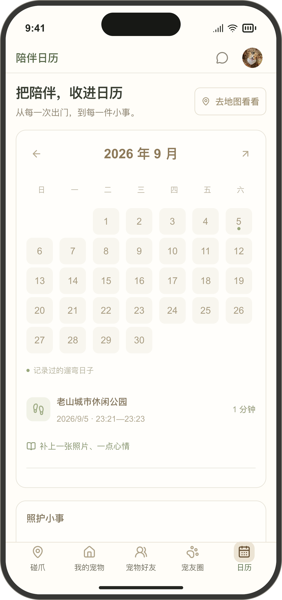 2026年9月日历标记记录日，下方展示老山公园的一次本机遛弯，可补照片和心情。本图未展示未来邀请，不能称为计划与历史同屏。 | 私人回忆填写画面见IMG-07。此图只有本机遛弯记录，未提供未来邀请或完成回忆详情画面。 |

<!-- /PZ-GALLERY-IMG-09-01 -->

## 我的工具页与扫码

### 我的、设置与隐私

右上头像进入全屏“我的”，集合档案、扫一扫、我的碰爪码、约遛、地点/帖子收藏、日历、设置、隐私、关于。普通子页返回我的；隐私从设置进入就返回设置，从我的直接进入就返回我的；关闭回原主页面。点击收藏内容会先关闭个人层再打开目标。[PG-14/15，E11]

默认遛弯时长设置保存本机，不改变每次主动共享原则。隐私页的“先好友再联系”是说明，不是可关闭陌生申请的开关；正式账号、注销和隐私政策仍待开发。对应PZ-ME-01/02、PZ-SYS-02，AT-19/20。

### 扫一扫与我的碰爪码

用户点击开启相机后才请求后置摄像头，不请求麦克风；拒绝相机可用相册识码。识别已知他人码先停止视频再打开名片，不自动申请好友；本人码、未知码、普通URL、无二维码图片给错误提示，不自动外跳。返回、关闭、切后台和异常需要释放镜头，回到页面需再次主动开启。

自己的碰爪码可展示并保存640px PNG。当前只识别演示白名单，自己的载荷为me，每个浏览器都会解释为自己，因此尚不能用来完成真实A/B跨设备身份绑定。真实码解析、失效和撤销契约见PZ-QR-03。相机历史补测使用合成环境，真机相机与相册仍需执行AT-21–23。[PG-15，E10/H02]

### IMG-10 我的、扫一扫与碰爪码

工具首页见IMG-01，本组依次展示扫一扫待开启、演示身份码、设置、无活动时的隐私说明、收藏空态、已收藏帖子与关于。30b是切换到帖子收藏后的数据状态，不是30向下滚动。未提供相机拒绝、识别成功、本人码、无效码或退出清理图片；真实扫码能力继续按验收方案验证。

<!-- PZ-GALLERY-IMG-10-01 -->

| 图25 · 扫一扫／相机待开启 | 图26 · 我的碰爪码／演示身份码 |
| --- | --- |
| 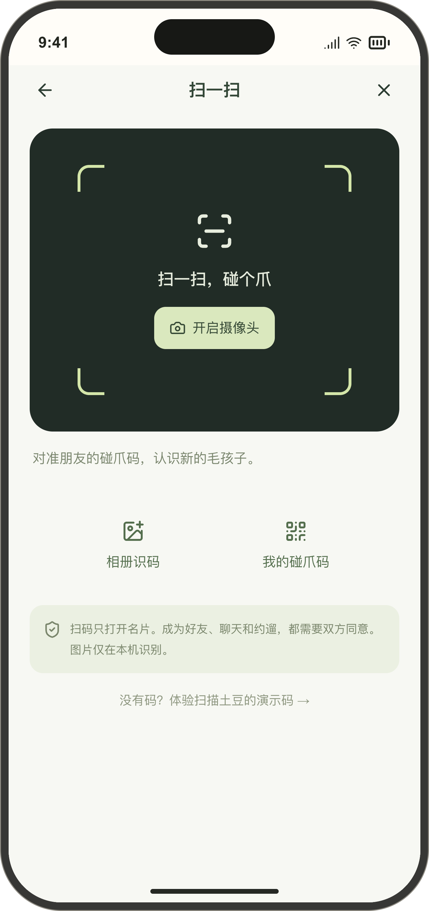 用户主动开启摄像头，也可使用相册识码或演示码。扫码先打开名片，不自动加好友；本图尚未授权或启动相机。 | 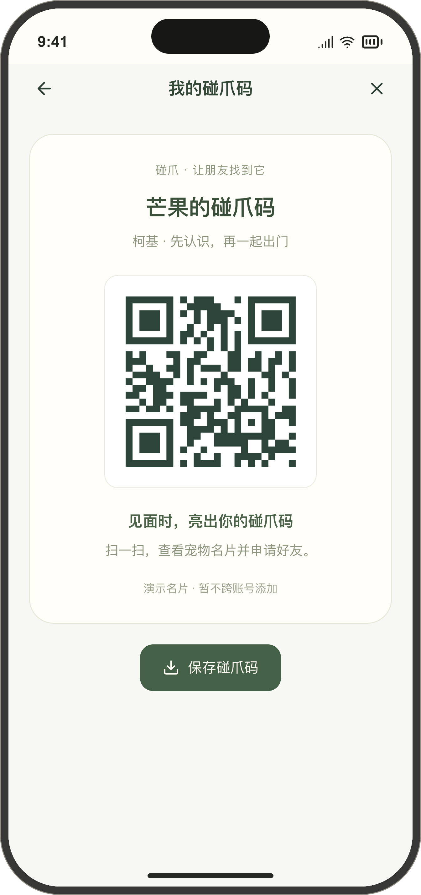 展示芒果的演示码，并可保存碰爪码PNG；图中明确暂不跨账号添加。现有me载荷不能用于真实A/B跨设备身份绑定。 |

<!-- /PZ-GALLERY-IMG-10-01 -->

<!-- PZ-GALLERY-IMG-10-02 -->

| 图28 · 设置／默认时长 | 图29 · 隐私与社交／无进行中遛弯 |
| --- | --- |
| 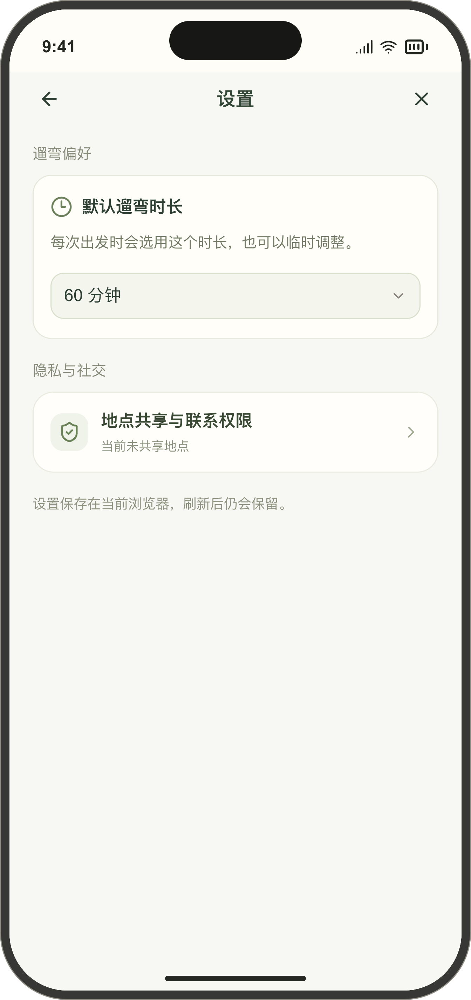 设置默认遛弯时长，并可进入地点共享与联系权限。设置保存在当前浏览器；记住时长不等于下次自动开启共享。 | 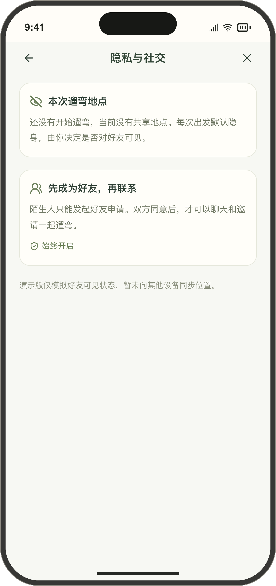 当前没有活动和共享地点；页面说明每次默认隐身、先好友再联系始终生效。该联系说明不是关闭陌生申请的开关。 |

<!-- /PZ-GALLERY-IMG-10-02 -->

<!-- PZ-GALLERY-IMG-10-03 -->

| 图30 · 我的收藏／地点空状态 | 图30b · 我的收藏／帖子列表 |
| --- | --- |
| 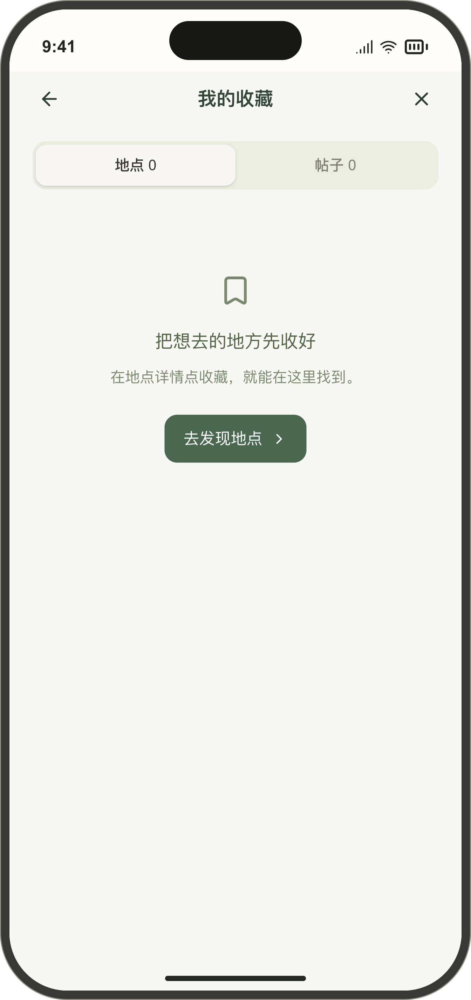 地点与帖子均为0，地点页显示空态和去发现地点入口。收藏地点保存在本机，不会自动向好友共享。 | 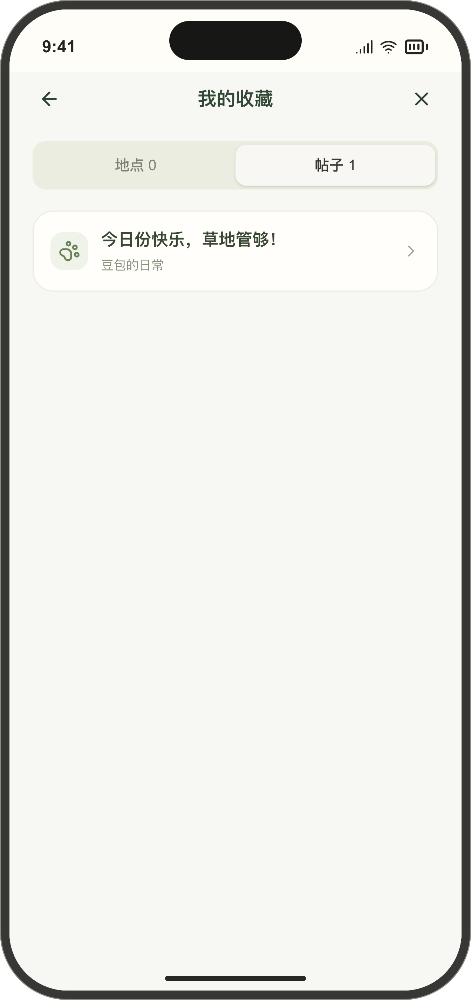 切换到帖子筛选，显示已收藏的豆包日常，可进入帖子详情。本图与30是收藏类型及数据状态差异，不是下滚位置。 |

<!-- /PZ-GALLERY-IMG-10-03 -->

<!-- PZ-GALLERY-IMG-10-04 -->

| 图31 · 关于碰爪／Web演示说明 | 阅读提示 |
| --- | --- |
| 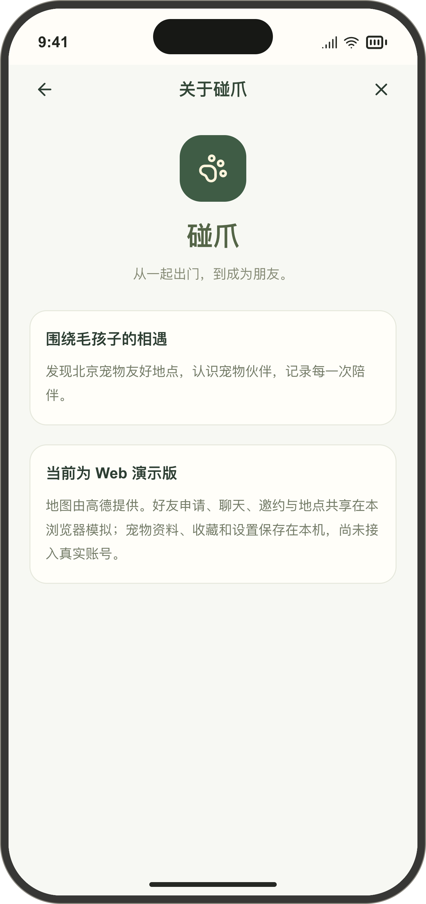 说明围绕宠物相遇的定位及当前Web阶段；页面明确好友、聊天、邀请和共享在本浏览器模拟，尚未接入真实账号。 | 本组没有相机拒绝、识别成功、本人码、无效码或退出清理画面；扫码错误与资源清理仍须按AT-21–23执行。 |

<!-- /PZ-GALLERY-IMG-10-04 -->

## 图片交付与后续维护

### 图片清单

IMG-01导航与工具入口1张；IMG-02地图1张；IMG-03地点和导航提示4张；IMG-04档案2张；IMG-05好友列表与关系名片6张；IMG-06消息与约遛5张；IMG-07共享生命周期4张；IMG-08宠友圈6张；IMG-09日历1张；IMG-10扫码与其他工具7张。共37张，每张在本文使用一次，按两列对照排列；奇数项右栏保留阅读提示，不制作字迹过小的拼接长图。逐张文件、页面状态与图注同步维护在[图片清单](maintenance/product-image-manifest.json)。

每张图片的表头注明原文件图号和页面状态，图注说明关键操作及实现边界。沿用本文PG、PZ、IMG编号；原始文件编号仅用于核对素材，不是新的需求编号。后续补图需记录来源、版本和制作日期；设计稿、历史版本与真实测试截图分别标明。未提供的邀请取消或过期、关系拒绝或撤回、扫码异常及跨设备同步状态继续保留文字说明和待执行验收，不再为填图重新截图。

### 图文不一致时的处理

先对比源码基线、图片日期和PRD状态；记录差异，不为了配图把待开发写成已实现。仅补图片不改变已批准范围；任何新状态、权限或入口先回到PRD/决策表评审。Mermaid原文在信息架构、状态与数据模型文档中维护，流程变化同步更新。
